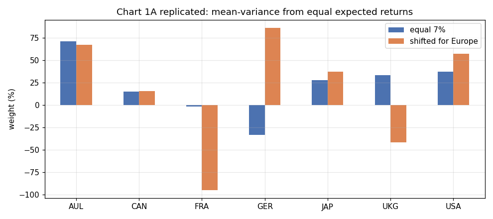
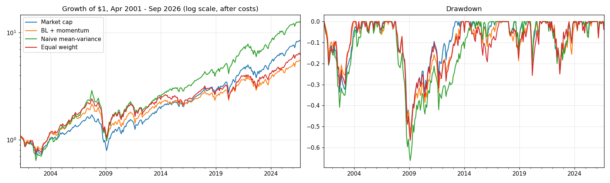

# Black-Litterman: replicating He & Litterman (1999)

A replication of Guangliang He and Robert Litterman, *The Intuition Behind Black-Litterman Model Portfolios* (Goldman Sachs Investment Management Research, December 1999), followed by an out-of-sample test of the same model on seven country ETFs from 2001 to 2026.

Everything is in one notebook: [`He_Litterman_1999_Replication.ipynb`](He_Litterman_1999_Replication.ipynb).

## What was replicated

| Paper | Result here |
|---|---|
| Table 1, equilibrium returns from reverse optimisation | all 7 match to the printed decimal |
| Chart 1A, mean-variance from equal returns (71.4%, −33.5%, −94.8% quoted in the text) | exact |
| Chart 1B/1C, view written into returns by hand | the chart's labels reproduce Chart 1C; the rules described in the text don't (a small inconsistency in the paper) |
| Charts 2–3, one and two views | the deviation from market weights is exactly the view portfolios (error ~1e-16); Λ from regression equals the Appendix B formula |
| Chart 4, stronger view / less confidence | 0.28/0.41, 0.28/0.53, 0.18/0.53, in line with the bars |
| Charts 5–7, risk, budget and beta constraints | optimiser matches the Appendix C closed forms to ~1e-8; weights within 1–2 points of the bars |



## Out-of-sample test, Apr 2001 – Sep 2026

Monthly rebalancing over EWA, EWC, EWQ, EWG, EWJ, EWU and SPY. The prior uses a 60-month covariance and cap weights drifted from the paper's 1999 weights. The view is 12-1 momentum, long the top two markets and short the bottom two, with q = 5%. Long-only, 10 bp per dollar traded.

| | CAGR | Vol | Sharpe | Max DD | Turnover / month |
|---|---|---|---|---|---|
| Market cap | 8.7% | 15.2% | 0.51 | −53.6% | 0.1% |
| BL + momentum | 7.0% | 15.8% | 0.40 | −54.2% | 47% |
| Naive mean-variance | 10.4% | 18.6% | 0.53 | −66.3% | 13% |
| Equal weight | 7.4% | 17.1% | 0.40 | −56.7% | 1.9% |

Over this period the momentum view had no edge (−0.1% a year, t = −0.07), so tilting towards it cost return. Naive mean-variance kept 88% in one market on average. The notebook goes through why, and shows a sensitivity grid over q and confidence.



## Data

- The paper's Tables 1 and 2 (typed in from Appendix A)
- Yahoo Finance monthly prices, Mar 1996 – Sep 2026 (`data/country_etfs_monthly.csv`)
- FRED 3-month T-bill, TB3MS (`data/tb3ms.csv`)
- World Bank market capitalisation, CM.MKT.LCAP.CD, only used as a check (`data/worldbank_market_cap.csv`)

The CSVs are included, so the notebook runs offline and gives the same numbers. Delete them to pull fresh data.

## Running it

```bash
pip install -r requirements.txt
jupyter notebook He_Litterman_1999_Replication.ipynb
```

## References

- He, G. and Litterman, R. (1999). *The Intuition Behind Black-Litterman Model Portfolios*. Goldman Sachs Investment Management Research.
- Black, F. and Litterman, R. (1992). Global Portfolio Optimization. *Financial Analysts Journal*, 48(5), 28–43.
- Asness, C., Moskowitz, T. and Pedersen, L. (2013). Value and Momentum Everywhere. *Journal of Finance*, 68(3), 929–985.
